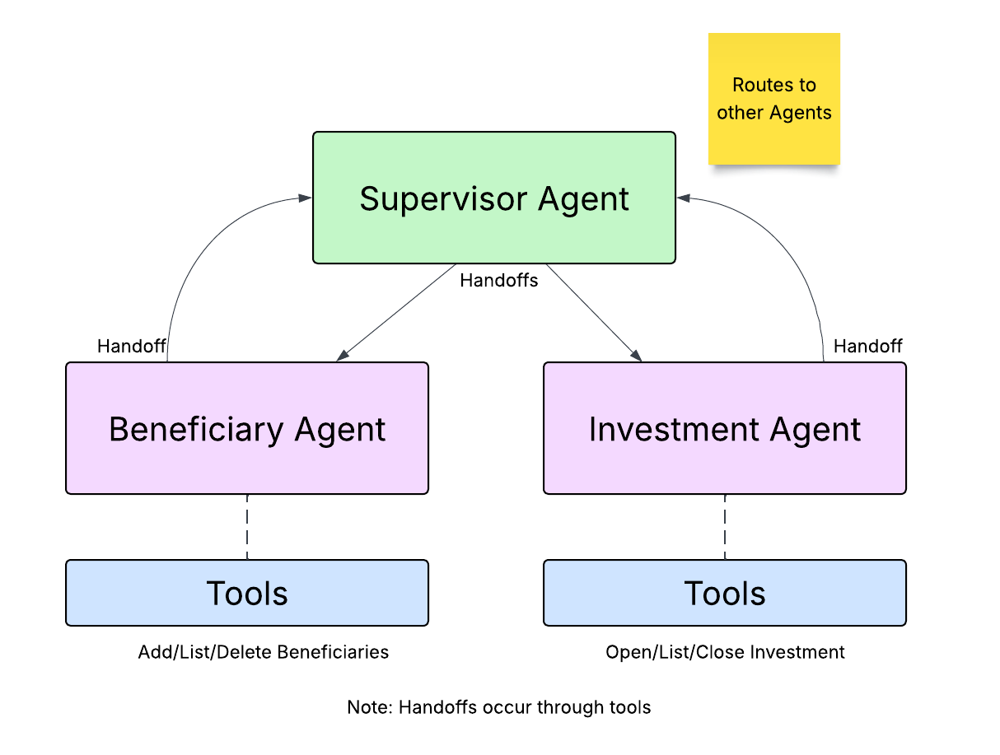

# Wealth Management Agent Example using Pydantic AI Framework

This project demonstrates how to use [Pydantic AI Framework](https://ai.pydantic.dev/) 
with multiple agents working together. It leverages the supervisor pattern to "hand off" work to agents that have specific knowledge of a certain domain. 

You will find a version of just using the Pydantic AI Framework and another version
that leverages [Temporal](https://temporal.io) to wrap the agentic flow with Temporal.



The vanilla Pydantic AI framework version of this example is located [here](src/py_supervisor/README.md).

The Temporal version of this example is located [here](src/temporal_supervisor/README.md)

Scenarios currently implemented include:
* Add Beneficiary - add a new beneficiary to your account
* List Beneficiaries - shows a list of beneficiaries and their relationship to the account owner
* Delete Beneficiary - delete a beneficiary from your account
* Open Investment Account - in the Temporal version, opens a new investment account by starting a child workflow. The agent asks you to confirm or update your details (KYC), then the account waits for a compliance approval signal before it is created. The account opening workflow can run in Python (default) or Java. The standalone Pydantic AI version simply adds the account (no KYC, compliance approval or saga)
* List Investments - shows a list of accounts and their current balances
* Close Investment Account - closes an investment account
* Off-topic questions - questions that aren't about beneficiaries or investment accounts are politely declined by the supervisor agent (handled in the agents' prompts)

You can run through the scenarios with the Temporal version using a [Web Application](src/frontend/README.md)
that talks to the [API](src/api/README.md).

The Temporal version also has a chaos panel that injects failures (API and LLM outages, rate limits, a saga rollback and a bug in workflow code) to show how Temporal handles them. See
[Failure scenarios](src/temporal_supervisor/README.md#failure-scenarios-chaos-panel).

## Prerequisites
* [uv](https://docs.astral.sh/uv/) - Python package and project manager
* Python 3.14 or later (`requires-python` in `pyproject.toml`). `uv sync` can install it for you
* [OpenAI API Key](https://platform.openai.com/api-keys) - Your key to accessing OpenAI's LLM
* [Temporal CLI](https://docs.temporal.io/cli#install) - Local Temporal service (Temporal version only)
* [Redis](https://redis.io/downloads/) - Stores conversation history and the chaos panel flags (Temporal version only)
* [Node.js](https://nodejs.org/en/download) and npm - Only needed for the [Web Application](src/frontend/README.md)
* [Java](https://adoptium.net/) JDK 25 (optional) - Only needed for the [Java Open Investment Account Workflow](java/README.md). The Gradle wrapper (Gradle 9.8.2) is included, so you don't need to install Gradle

## Set up Python Environment
```bash
uv sync
```

## Set up your OpenAI API Key
 
```bash
cp setoaikey.example setoaikey.sh
chmod +x setoaikey.sh
```

Now edit the setoaikey.sh file and paste in your OpenAI API Key.
It should look something like this:
```text
export OPENAI_API_KEY=sk-proj-....
```

The start scripts source `setoaikey.sh` from the repository root.

## Getting Started

See the Pydantic AI Framework version [here](src/py_supervisor/README.md)
and the Temporal version of this example [here](src/temporal_supervisor/README.md).

## Resetting the demo data

Opening and closing accounts and adding or deleting beneficiaries change the JSON files in `data/`.
To put them back to their original state:

```bash
git checkout data/
```

## Running the tests

```bash
uv run pytest
```

The tests need no OpenAI API key or Redis. Some run against a local Temporal test server, which is
downloaded automatically on the first run. See the [Temporal version](src/temporal_supervisor/README.md#running-the-tests)
for the Java and frontend tests.
