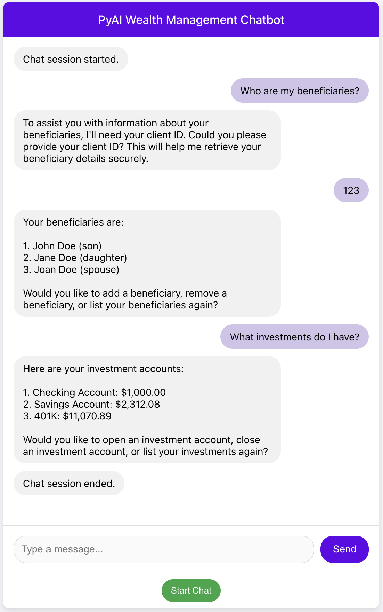

# React Web App for Wealth Management

An easy to use web based front end for the Wealth Management Agent.
It uses the [API](../api/README.md) to interact with Temporal.

## Prerequisites

* [Node.js](https://nodejs.org/en/download) and npm
* The API, the Temporal worker, a Temporal service and Redis running, as described in the
  [Temporal version README](../temporal_supervisor/README.md) and the [API README](../api/README.md)

Note that the web application communicates directly with the API and the API is what
communicates with Temporal running locally or in the cloud.

The API URL is set in `src/config.js` (default `http://127.0.0.1:8000`). The API only accepts requests
from `http://localhost:3000` and `http://127.0.0.1:3000` (CORS), so run the web app on port 3000, the
`npm start` default.

## Install Dependencies
From the repository root:

```bash
cd src/frontend
npm install
```

## Running the Web App
```bash
cd src/frontend
npm start
```

A browser window opens at http://localhost:3000. Click **Start Chat** to begin a conversation and
**End Chat** to end it.

Remember, if you are opening a new investment account, in another terminal
select either
### Send the Compliance Reviewed Signal (Local)
```bash
cd src/temporal_supervisor
./localsendcomplianceapproval.sh "<Child Workflow ID>"
```

or
### Send the Compliance Reviewed Signal (Cloud)
```bash
cd src/temporal_supervisor
./cloudsendcomplianceapproval.sh "<Child Workflow ID>"
```

The child workflow ID is shown at the end of the agent's reply when it asks you to confirm your
information. See [the Temporal version README](../temporal_supervisor/README.md#finding-the-child-workflow-id)
for its format and how to find it in the Temporal UI.

## Chaos panel

Click **Chaos** in the chat header to open the chaos panel, which turns failure injection on and off
(API and LLM outages, rate limits, a saga rollback and a bug in workflow code) and lists the failures as
they happen. See [Failure scenarios](../temporal_supervisor/README.md#failure-scenarios-chaos-panel).

## Running the tests

```bash
cd src/frontend
npm test
```

`npm test` runs in watch mode; press `q` to quit. To run the tests once, use `CI=true npm test`.

## Example

Here's an example screenshot of the web application running:



## Comments

Each time you click **Start Chat**, the web app starts a new chat workflow with a random workflow ID
that starts with `pyai-temporal-agent-` (see `src/App.js`).
