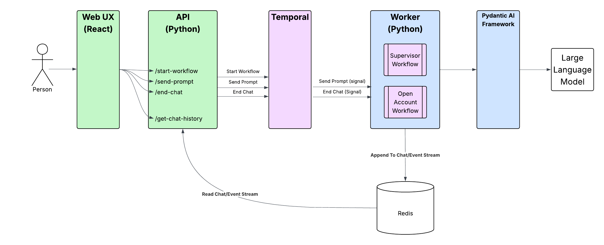
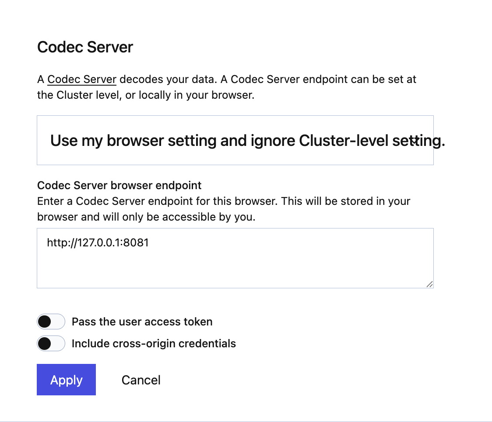
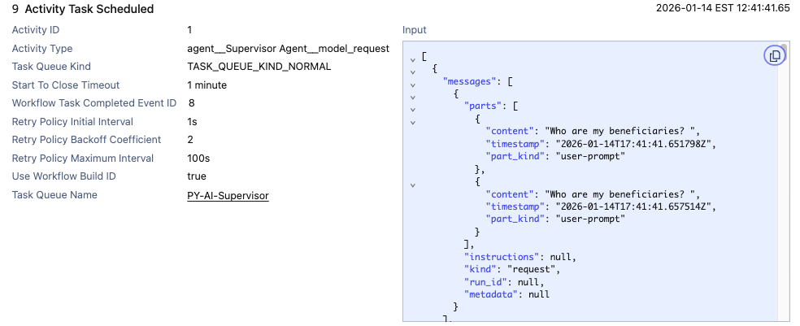
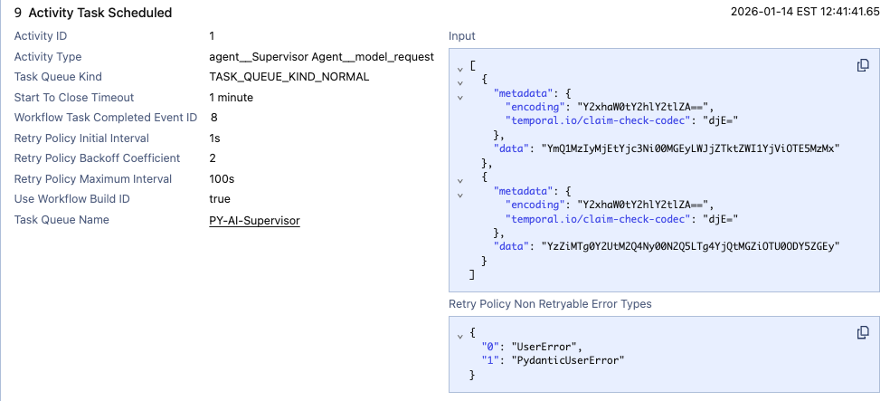
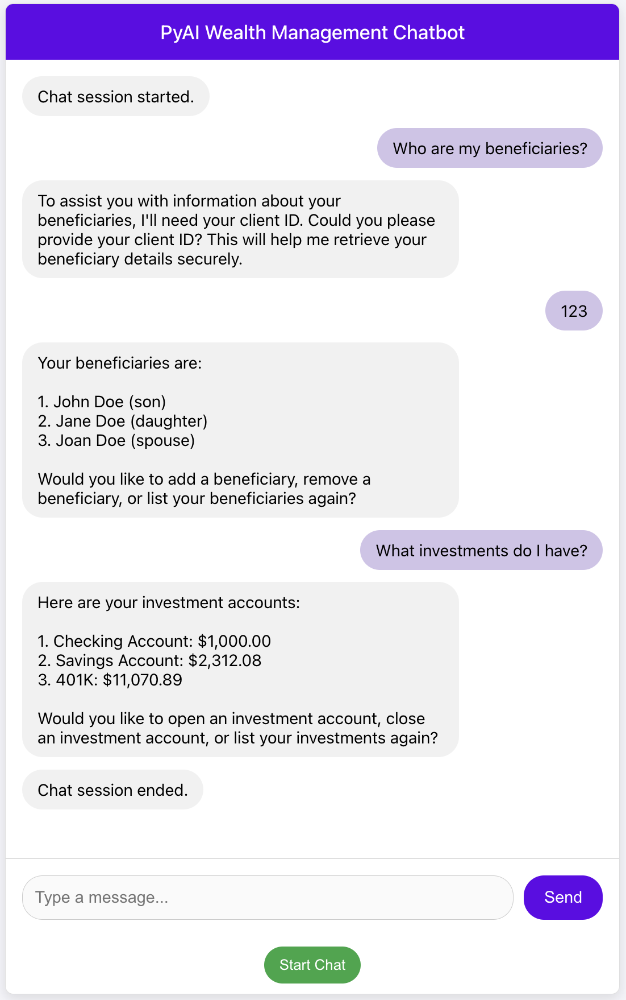
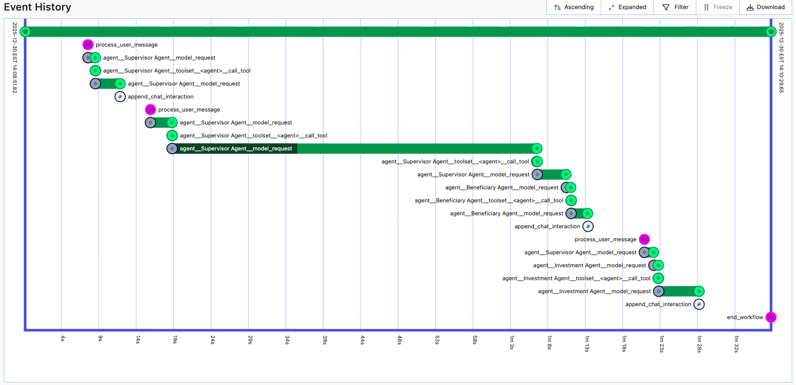

# Wealth Management Multi-Agent Example using Pydantic AI Framework 

Demonstrates how to use the Pydantic AI Framework with Temporal. It shows how to coordinate between multiple agents that deal with specific domains of expertise.

The supervisor agent is responsible for directing the actions to the appropriate
helper agents.

Scenarios currently implemented include
* Add Beneficiary - add a new beneficiary to your account
* List Beneficiaries - shows a list of beneficiaries and their relationship to the account owner
* Delete Beneficiary - delete a beneficiary from your account. The agent asks you to confirm first
* Open Investment Account - opens a new investment account by starting a child workflow. The agent asks you to confirm or update your details (KYC), then the account waits for a compliance approval signal before it is created. The account opening workflow can run in Python (default) or Java. See [How the Open Account functionality works](#how-the-open-account-functionality-works)
* List Investments - shows a list of accounts and their current balances
* Close Investment Account - closes an investment account. The agent asks you to confirm first
* Off-topic questions - questions that aren't about beneficiaries or investment accounts are politely declined by the supervisor agent (handled in the agents' prompts)

## Application Architecture
The overall application architecture looks like this:



There is a React UX which is where the customer interacts with the application.
The React UX leverages an [API](../api/README.md) which exposes endpoints to start a workflow, send a prompt,
retrieve the chat history, end the chat, and drive the chaos panel. The React frontend uses adaptive polling
to retrieve new events (stored in Redis) through the API.

The API in turn, communicates with Temporal to start workflows and send signals. Finally, 
the worker contains the supervisor workflow which contain the agents and business logic 
that drive the agentic application.

## Prerequisites
* [uv](https://docs.astral.sh/uv/) - Python package and project manager
* Python 3.14 or later (`requires-python` in `pyproject.toml`). `uv sync` can install it for you
* [OpenAI API Key](https://platform.openai.com/api-keys) - Your key to accessing OpenAI's LLM
* [Temporal CLI](https://docs.temporal.io/cli#install) - Local Temporal service
* [Redis](https://redis.io/downloads/) - Stores conversation history and the chaos panel flags
* [Node.js](https://nodejs.org/en/download) and npm - Runs the React UX
* [Java](https://adoptium.net/) JDK 25 (optional) - Only needed to run the [Java Open Investment Account Workflow](../../java/README.md). The Gradle wrapper (Gradle 9.8.2) is included, so you don't need to install Gradle

## Set up Python Environment
From the repository root:

```bash
uv sync
```

## Set up your OpenAI API Key

From the repository root:

```bash
cp setoaikey.example setoaikey.sh
chmod +x setoaikey.sh
```

Now edit the setoaikey.sh file and paste in your OpenAI API Key.
It should look something like this:
```bash
export OPENAI_API_KEY=sk-proj-....
```

The worker and API start scripts source `setoaikey.sh` from the repository root.

## Set up Redis

Redis is used for storing conversation history. If you don't have an existing Redis server, you can run one locally after installing it. 

In a new terminal / shell run the following command:

```bash
redis-server
```

By default, the application expects to find Redis running locally. You can override the location of Redis
for the Python components (worker, API, codec server) by setting the environment variables:

```bash
export REDIS_HOST=localhost
export REDIS_PORT=6379
```

The Java worker doesn't read these; it uses `spring.data.redis` in `java/src/main/resources/application.yaml`
(only needed for claim check).

## Set up Claim Check (optional)

An optional configuration is to substitute the data sent to Temporal (e.g. function/method parameters and return values)
with an ID. This is known as the [Claim Check Pattern](https://www.enterpriseintegrationpatterns.com/patterns/messaging/StoreInLibrary.html). 
The original data is stored in Redis. This uses a 
[Custom Payload Codec](https://docs.temporal.io/develop/python/converters-and-encryption#custom-payload-codec) 
that intercepts data going to Temporal Cloud, replaces it with a GUID. When the data is retrieved, it looks up the GUID 
replaces it with the data stored in Redis.

From the repository root:

```bash
cp setclaimcheck.example setclaimcheck.sh
chmod +x setclaimcheck.sh
```

Now edit the setclaimcheck.sh file and fill in the location of Redis
It should look something like this:
```bash
export USE_CLAIM_CHECK=true
export REDIS_HOST=localhost
export REDIS_PORT=6379
```

Save the file and be sure that you have Redis running. For example:

```bash
redis-server
```

Note that the application assumes you only have one Redis server that is used by the application for storing the 
conversation history and is also used if Claim Check has been enabled. 

Be aware that using a claim check pattern introduces performance costs by doing remote calls to Redis for every payload. 
Also, make sure your Redis implementation is rock solid as any downtime will directly affect your workflows. 

Claim check is optional. The start scripts source `setclaimcheck.sh` from the repository root when it
exists; if you haven't created it, they run without claim check.

## Run Codec Server for Claim Check (optional)
If you have decided to set up the Claim Check above, you will 
most likely want to also run a Codec Server to be able to see the actual sent to 
the workflow and activities. 

Be sure you have updated the setclaimcheck.sh as mentioned above.

To run the Codec Server:
```bash
cd src/temporal_supervisor
./startcodecserver.sh
```

And of course, make sure that your Redis Server is up and running. 

Once it's up and running, the default endpoint is http://127.0.0.1:8081.

Open up your browser and navigate to the Temporal UI. Locally, open it at exactly http://localhost:8233
(the codec server only accepts requests from that origin and https://cloud.temporal.io, so
http://127.0.0.1:8233 won't work). For Temporal Cloud that will be https://cloud.temporal.io

In the upper right, there is an icon that looks like glasses. Click on that and you 
can configure your codec server. 

Change the drop down to "Use my browser setting and ignore Cluster-level setting".

Use the endpoint of your codec server (default is http://127.0.0.1:8081). Be sure there are no 
extra spaces at the end of the URL or it will not work. You can turn off the two options - Pass the 
user access token and Include cross-origin credentials. Click on apply and you have configured 
the codec server. 



As you run through different scenarios, you'll be able to see the decoded values in the browser.



If you remove the codec server settings, you won't be able to see anything other than a BASE64 Encoded ID.



## Running the Demo Locally
Start Temporal Locally.

```bash
temporal server start-dev
```

In another terminal, start the worker.

### Start the Worker using the Python Open Investment Account Workflow (default)

```bash
cd src/temporal_supervisor
./startlocalworker.sh
```

If you want to use the Java Open Investment Account Workflow,
you need to specify the name of the Task Queue when running the Python worker:

```bash
cd src/temporal_supervisor
./startlocalworker.sh Open-Account-Java
```

and then start the Java worker, making sure you pass in the same name as you did 
when you started the Python worker:

```bash
cd java
./startlocalworker.sh Open-Account-Java
```

### Start the API

In another terminal, start the REST API.

```bash
cd src/api
./startlocalapi.sh
```

And in another terminal, start the UX. 

### Start the UX
```bash
cd src/frontend
npm install
npm start
```

A new browser window opens where you can interact with the application. See the [frontend README](../frontend/README.md).

If you are opening a new investment account, in another terminal
### Send the Compliance Reviewed Signal
```bash
cd src/temporal_supervisor
./localsendcomplianceapproval.sh "<Child Workflow ID>"
```

### Finding the child workflow ID

The child workflow ID has the format `OpenAccount-<chat workflow ID>-<client ID>-<account name>`, for example
`OpenAccount-pyai-temporal-agent-abc123-123-Vacation` (the web app gives each chat a random workflow ID
starting with `pyai-temporal-agent-`). Quote it if the account name contains a space.

It is shown at the end of the agent's reply when it asks you to confirm your information, for example
`(Workflow ID: OpenAccount-pyai-temporal-agent-abc123-123-Vacation)`. You can also find it in the Temporal UI
(http://localhost:8233 locally): look for the running `OpenInvestmentAccountWorkflow`, which is a child of
the chat's `WealthManagementWorkflow`.

Here is a screenshot of the UX walking through a few scenarios:



Here is a sample event history shown in the Temporal UX



## How the Open Account functionality works

1. When the customer asks to open an account, the Investment Agent hands off to the Open Account Agent
   (`route_from_investment_to_open_account`) with the account name and initial amount.
2. The Open Account Agent's `respond_about_account_opening` output function first runs the
   `validate_new_account` activity (business rules: $100 to $1,000,000) and the `find_promotion` activity,
   then starts the `OpenInvestmentAccountWorkflow` child workflow (`start_account_opening_workflow`) on the
   `TEMPORAL_TASK_QUEUE_OPEN_ACCOUNT` task queue. The child workflow is started from workflow code, not from
   a tool, because Pydantic AI runs tools as activities. Only one opening per account name per chat can run
   at a time.
3. KYC: the child workflow loads the client's details (`get_client` activity). The agent fetches them with
   the `get_client_details` update (via the `get_current_client_info` activity), shows them to the customer
   with the child workflow ID, and asks them to confirm. In a later message the customer either confirms,
   and the agent calls `approve_client_kyc` (the `verify_kyc` signal), or gives new details, and the agent
   calls `update_kyc_details` (the `update_client_details` update, which saves them with the
   `update_client` activity and also completes KYC).
4. The child workflow then waits for the `compliance_approved` signal, which you send with
   `localsendcomplianceapproval.sh` / `cloudsendcomplianceapproval.sh`.
5. After approval it runs a saga: create the account record (`open_investment`), transfer the deposit from
   the linked bank account (`debit_linked_account`), and register with the custodian (`register_account`).
   If a step fails non-retryably, the completed steps are undone in reverse order (`credit_linked_account`,
   then `remove_investment`).
6. Each state change is signaled to the chat workflow (`update_account_opening_state`). The chat workflow
   shows it in the UI as a status update and keeps the latest state per child workflow, which the Open Account
   Agent reads with its `get_account_opening_status` tool. When the opening ends (`Complete` or
   `Rolled back...`), the chat workflow adds a note to the conversation history and, if the Open Account
   Agent is active, hands the conversation back to the Investment Agent.
7. If the *Bug in workflow code* chaos switch is on, `find_promotion` returns a `WELCOME-BONUS` promo code
   and the child workflow hits a bug in its welcome-bonus code after compliance approval. See
   [Bug in the workflow code](#bug-in-the-workflow-code).

To exercise the account opening workflow on its own, without the chat or the LLM, `startlocalopenaccount.sh`
starts a local worker without the agents (`SKIP_AGENTS=True`, so no OpenAI key is needed) in the background
and runs `run_open_account_workflow.py`, which opens three accounts for client `123` (`Vacation`,
`Vacation2`, `Vacation3`). The third one waits for you to send the compliance approval. The script stops
the worker it started when the scenarios finish, and can be run from any directory. Temporal and Redis
must be running, and no other Python worker should be polling the same task queue:

```bash
src/temporal_supervisor/startlocalopenaccount.sh
# in another terminal
cd src/temporal_supervisor
./localsendcomplianceapproval.sh testing-open-investment-account-workflow3
```

With a task queue name, the workflow runs on that queue (`TEMPORAL_TASK_QUEUE_OPEN_ACCOUNT`), so you
can run the same scenarios against the Java workflow (start `java/startlocalworker.sh <queue>` first):

```bash
src/temporal_supervisor/startlocalopenaccount.sh Open-Account-Java
```

## Failure scenarios (chaos panel)

Click **Chaos** in the chat header to open the chaos panel. Its switches inject
failures at runtime: activities, agent tools and the model read the flags from
Redis on every attempt, so you can turn a failure on and off mid-conversation
without restarting anything. The panel also lists each injected failure as it
happens (activity and attempt number). Open the [Temporal UI](http://localhost:8233)
alongside it to show the pending activity, its attempt count, and the last
failure. **Reset all** turns every flag off.

| Scenario | How to show it | What Temporal does |
|---|---|---|
| **Tool / API down** | Turn on *Core banking API down*, then ask to list your investments or beneficiaries (or open an account, so it fails after compliance approval). Turn it off. | The tool activity retries (1s backoff, capped at 5s) for as long as the outage lasts. The agent waits mid-turn and answers once the API is back. Nothing is lost or re-asked. |
| **LLM down** | Turn on *OpenAI API down* and send a message. Turn it off. | The model call is an activity, so it retries the same way (capped at 10s). The conversation picks up exactly where it was. |
| **LLM rate limited (reactive)** | Turn on *OpenAI rate limited (429)* and send a message. | The model raises an `ApplicationError` with `next_retry_delay` (15s, like a `Retry-After` header), which overrides the retry policy's backoff. Real OpenAI 429s are handled the same way (`ChaosAwareModel` in `model_config.py`). |
| **LLM rate limited (proactive)** | Start the worker with `LLM_MAX_CALLS_PER_SECOND=0.2 ./startlocalworker.sh`, then chat in several browser tabs at once. | Model calls run on their own task queue (`TEMPORAL_TASK_QUEUE_LLM`, default `PY-AI-Supervisor-llm`). The Temporal service dispatches at most that many per second across *all* workers, so calls queue up instead of hitting the provider's limit. Tools on the main queue aren't slowed down. |
| **Business rule (non-retryable)** | Ask to open an account with $2,000,000 (or less than $100). | `validate_new_account` raises a non-retryable `ApplicationError`: one attempt, no retries. The reason goes back to the customer before any account opening starts. Compare it with *Tool / API down* in the Temporal UI. |
| **Saga** | Turn on *Custodian rejects new accounts* (and *Slow account-opening steps* so you can watch), then open an account through compliance approval. Without flags: as client `123`, open an account with $300,000 (the linked bank account has $250,000). | After compliance approval the child workflow creates the account record, transfers the deposit from the linked bank account, and registers with the custodian. When a step fails non-retryably, the completed steps are undone in reverse order (refund, then remove the account). Compensations are activities too, so they are retried until they succeed. Kill the worker mid-rollback and the rollback still finishes. Transfers are idempotent, so a retried debit or refund never moves money twice. |
| **Bug in workflow code** | Turn on *Bug in workflow code*, then open an account through compliance approval. See below. | The workflow pauses at the failing line, keeping all its state, until a worker with fixed code picks it up. |

Every scenario works with both the Python and the [Java](../../java/README.md)
account opening workflow. The failures are injected in the Python activities,
which the Java workflow calls too, and both workflows implement the same saga and
the same kind of bug.

The linked bank balances and transfers are kept in `data/funding_accounts.json`. Account openings and
closings and beneficiary changes also modify the JSON files in `data/`. To reset the demo data after a few
runs, from the repository root:

```bash
git checkout data/
```

### Bug in the workflow code

Turn on **Bug in workflow code**, then open an account and approve KYC and
compliance. While the switch is on, `find_promotion` gives new account openings a
`WELCOME-BONUS` promo code, which is passed to `OpenInvestmentAccountWorkflow` as
part of its input. The welcome-bonus code path has a real bug, and openings
without the promo code never reach it:

* **Python** (`_welcome_bonus` in `workflows/open_account_workflow.py`) reads
  `inputs.initial_deposit`, a field that doesn't exist, and raises
  `AttributeError: 'OpenInvestmentAccountInput' object has no attribute 'initial_deposit'`.
* **Java** (`OpenInvestmentAccountWorkflowImpl.java`) looks up the promotion rate
  under the wrong key (`WELCOME_BONUS` instead of `WELCOME-BONUS`), and unboxing
  the missing rate raises a `NullPointerException`.

In both SDKs an ordinary exception fails the *workflow task*, not the workflow, so
the workflow stays **Running**, paused right after compliance approval with the
approval intact. The Temporal UI shows the failing workflow task and its stack
trace. Other conversations, and openings without the promo code, keep working.

Turning the switch off doesn't help: the promo code is part of the workflow's
input, so every retry hits the same line. The fix is code:

* Python: change `inputs.initial_deposit` to `inputs.initial_amount`, the line
  commented out above it, and restart the Python worker.
* Java: swap `PROMOTION_RATES` for the commented-out line above it, and restart
  the Java worker.

The workflow resumes on the server's next workflow-task retry and opens the
account with the bonus. Workflow-task retries back off over time, up to 10
minutes. If the fix is deployed within a couple of minutes, the workflow resumes
within about a minute.

After the demo, re-arm the bug:

```bash
git checkout src/temporal_supervisor/workflows/open_account_workflow.py
git checkout java/src/main/java/io/temporal/demo/wealthmanagement/workflow/OpenInvestmentAccountWorkflowImpl.java
```

## Running the tests

The Python tests (in `tests/`) cover the failure scenarios, the agents' handoffs and checks, off-topic
handling and the standalone version. The workflow tests run against a local Temporal test server
(downloaded automatically on first run) with stub activities. They need no OpenAI API key or Redis.
From the repository root:

```bash
uv run pytest
```

### Live agent handoff test

`tests/live_agent_handoffs.py` checks that the agents hand off to each other without involving the
customer. It runs the real `WealthManagementWorkflow` against the real OpenAI model, with the real
beneficiary and investment activities (which only read `data/*.json`); only the Redis event stream
activities are replaced with in-memory stand-ins, and the chaos flags are off, so Redis isn't needed.
The conversation is "Who are my beneficiaries?", "123", then "What investments do I have?". It checks
that the second reply lists client 123's beneficiaries and that the third, in the same turn, routes from
the Beneficiary Agent to the supervisor and on to the Investment Agent and lists the Checking, Savings and
401K accounts, without asking for the client ID again and without any agent mentioning a transfer. Each
run's transcript, with what each agent did, is printed.

It calls the paid OpenAI API, so it is not part of `uv run pytest` (the file name doesn't match
`test_*.py`) and is skipped when `OPENAI_API_KEY` isn't set. Run it from the repository root with:

```bash
source ./setoaikey.sh
LIVE_TEST_RUNS=10 uv run pytest tests/live_agent_handoffs.py -s
```

`LIVE_TEST_RUNS=<n>` repeats the conversation n times in one test (default 1), since model output varies.

For the Java workflow (JDK 25):

```bash
cd java
./gradlew test
```

For the React UX (watch mode; use `CI=true npm test` to run once):

```bash
cd src/frontend
npm install
npm test
```

## Running from the command line

Alternatively you can interact with workflow using the temporal CLI 

Start the worker in a new terminal:

```bash
cd src/temporal_supervisor
./startlocalworker.sh
```

And in another terminal you can run the following commands:

```bash
# starts a workflow execution
temporal workflow start --workflow-id ai-chat --type WealthManagementWorkflow --task-queue PY-AI-Supervisor 

# send it a request using a signal
temporal workflow signal --workflow-id ai-chat --name process_user_message --input '{"user_input":"Who are my beneficiaries?"}'

# retrieve the conversation (Pydantic AI model messages) directly from the workflow execution
temporal workflow query --workflow-id ai-chat --type get_chat_history

# send it the client id via a signal
temporal workflow signal --workflow-id ai-chat --name process_user_message --input '{"user_input":"123"}'

# ask about investments via a signal 
temporal workflow signal --workflow-id ai-chat --name process_user_message --input '{"user_input":"what investments do I have?"}'

# ends the workflow execution
temporal workflow signal --workflow-id ai-chat --name end_workflow
```

The chat workflow keeps the whole conversation in one workflow run. Long conversations would need
continue-as-new in production (see the TODO in `workflows/supervisor_workflow.py`).

## Environment variables

| Variable | Default | Used for |
|---|---|---|
| `OPENAI_API_KEY` | | The agents' model calls (set in `setoaikey.sh`). |
| `TEMPORAL_TASK_QUEUE` | `PY-AI-Supervisor` | Task queue of the chat workflow and the tools. The worker, API and Java worker must agree. |
| `TEMPORAL_TASK_QUEUE_OPEN_ACCOUNT` | value of `TEMPORAL_TASK_QUEUE` | Task queue of `OpenInvestmentAccountWorkflow`. The worker scripts set it from their optional argument (`./startlocalworker.sh Open-Account-Java`, via `setsplitworkflows.sh`); when it differs from `TEMPORAL_TASK_QUEUE`, the Python worker doesn't run the account opening workflow and the Java worker must. |
| `TEMPORAL_TASK_QUEUE_LLM` | `<TEMPORAL_TASK_QUEUE>-llm` (`PY-AI-Supervisor-llm`) | Task queue for the model calls. The old name `TEMPORAL_LLM_TASK_QUEUE` is still accepted. |
| `LLM_MAX_CALLS_PER_SECOND` | unset (no limit) | Most model calls per second the Temporal service dispatches from the LLM task queue, e.g. `LLM_MAX_CALLS_PER_SECOND=0.2 ./startlocalworker.sh`. |
| `REDIS_HOST` / `REDIS_PORT` | `localhost` / `6379` | Conversation events, chaos flags and claim check (Python components). |
| `USE_CLAIM_CHECK` | `False` | Enables the claim check codec (set in `setclaimcheck.sh`). |
| `SKIP_AGENTS` | `False` | Runs the worker without the agents (no supervisor workflow or model calls, so no OpenAI key); set by `startlocalopenaccount.sh`. |
| `TEMPORAL_ADDRESS` | `127.0.0.1:7233` | Temporal service address. |
| `TEMPORAL_NAMESPACE` | `default` | Temporal namespace. |
| `TEMPORAL_TLS_CLIENT_CERT_PATH` / `TEMPORAL_TLS_CLIENT_KEY_PATH` | | mTLS client certificate and key for Temporal Cloud (set in `setcloudenv.sh`). |

## Running the Demo in Temporal Cloud

Copy the setcloudenv.example, located in the src/temporal_supervisor folder, to the repository root and name it
setcloudenv.sh (it is gitignored). From the repository root:

```bash
cp  src/temporal_supervisor/setcloudenv.example setcloudenv.sh
```

Edit setcloudenv.sh to match your Temporal Cloud account:
```bash
export TEMPORAL_ADDRESS=<namespace>.<accountID>.tmprl.cloud:7233
export TEMPORAL_NAMESPACE=<namespace>.<accountID>
export TEMPORAL_TLS_CLIENT_CERT_PATH="/path/to/cert.pem"
export TEMPORAL_TLS_CLIENT_KEY_PATH="/path/to/key.key"
```

The cloud scripts (`startcloudworker.sh`, `startcloudapi.sh`, `cloudsendcomplianceapproval.sh`) source
`../../setcloudenv.sh`.

### Start the Worker

In a terminal, start the worker, using Temporal Cloud:

```bash
cd src/temporal_supervisor
./startcloudworker.sh
```

If you want to use the Java Open Investment Account Workflow,
you need to specify the name of the Task Queue when running the Python worker:

```bash
cd src/temporal_supervisor
./startcloudworker.sh Open-Account-Java
```

and then start the Java worker, making sure you pass in the same name as you did 
when you started the Python worker. See
[Running Using Temporal Cloud](../../java/README.md#running-using-temporal-cloud) in the Java README
for the PKCS8 key it needs.

```bash
cd java
./startcloudworker.sh Open-Account-Java
```

### Start the API

In another terminal, start the API using Temporal Cloud

```bash
cd src/api
./startcloudapi.sh
```

And in another terminal, start the UX:

### Start the UX
```bash
cd src/frontend
npm install
npm start
```

A new browser window opens where you can interact with the application. 

If you are opening a new investment account, in another terminal
### Send the Compliance Reviewed Signal (Cloud)
```bash
cd src/temporal_supervisor
./cloudsendcomplianceapproval.sh "<Child Workflow ID>"
```

See [Finding the child workflow ID](#finding-the-child-workflow-id). In Temporal Cloud, look for the
`OpenInvestmentAccountWorkflow` in your namespace at https://cloud.temporal.io.

